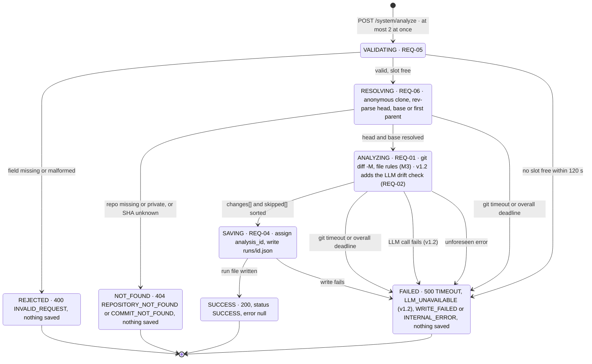

# M2 · Analysis lifecycle

**Question:** What can happen to one analysis request, and how does each path end?

These are the states of one request. The route rejects a missing field before `analyze()` runs, and every other state belongs to `analyze()`. The route maps each final state to its status code, so a later caller of `analyze()` gets the same outcomes. The lifecycle stays synchronous: a QUEUED state would break the pod contract.

- **Representation.** Four working states and four final states. Each final state names its HTTP status and error code. Two guards bound the load: a 120 s deadline per analysis (60 s per git call), which ends in 500 `TIMEOUT`, and at most two analyses at once, with extra requests waiting up to 120 s for a slot and then ending in 500 `TIMEOUT`. All four values live in config. From v1.2, a failed LLM call (down, timeout, rate limit or missing key) ends in 500 `LLM_UNAVAILABLE`. Any error nothing foresaw, such as an unexpected git failure, ends in 500 `INTERNAL_ERROR` (2026-10-25).
- **Property.** A request that ends anywhere but SUCCESS returns an `ErrorBody` and saves nothing, so a failed check is never reported as successful (REQ-05). The temporary clone is deleted when the `fetch()` block exits, success or not (REQ-06). `GET /system/analysis/{id}` returns a saved file byte for byte, or 404 when the id is unknown.
- **Checked by.** AC-07 and AC-08 (the 400 and 404 cases), connector test 6 (unknown SHA), AC-06 and T-05 (the saved file comes back unchanged), and a test that no temporary clone is left after an error.
