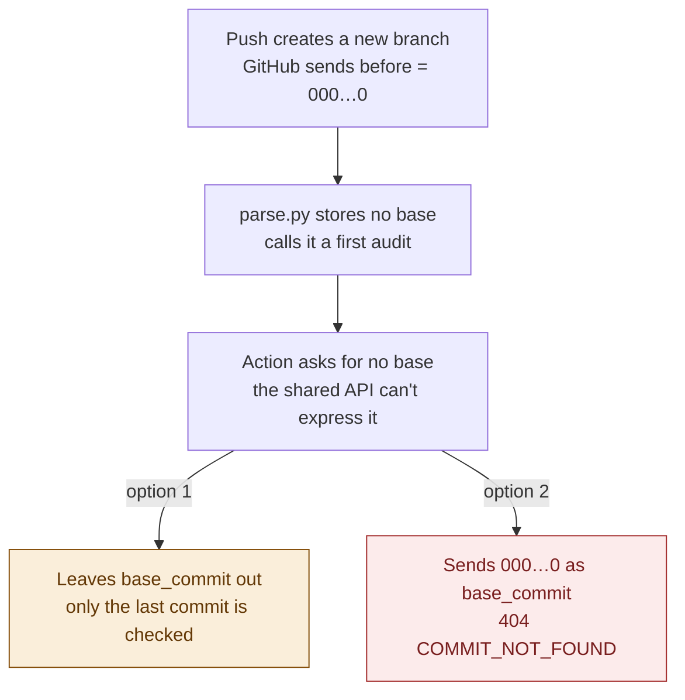
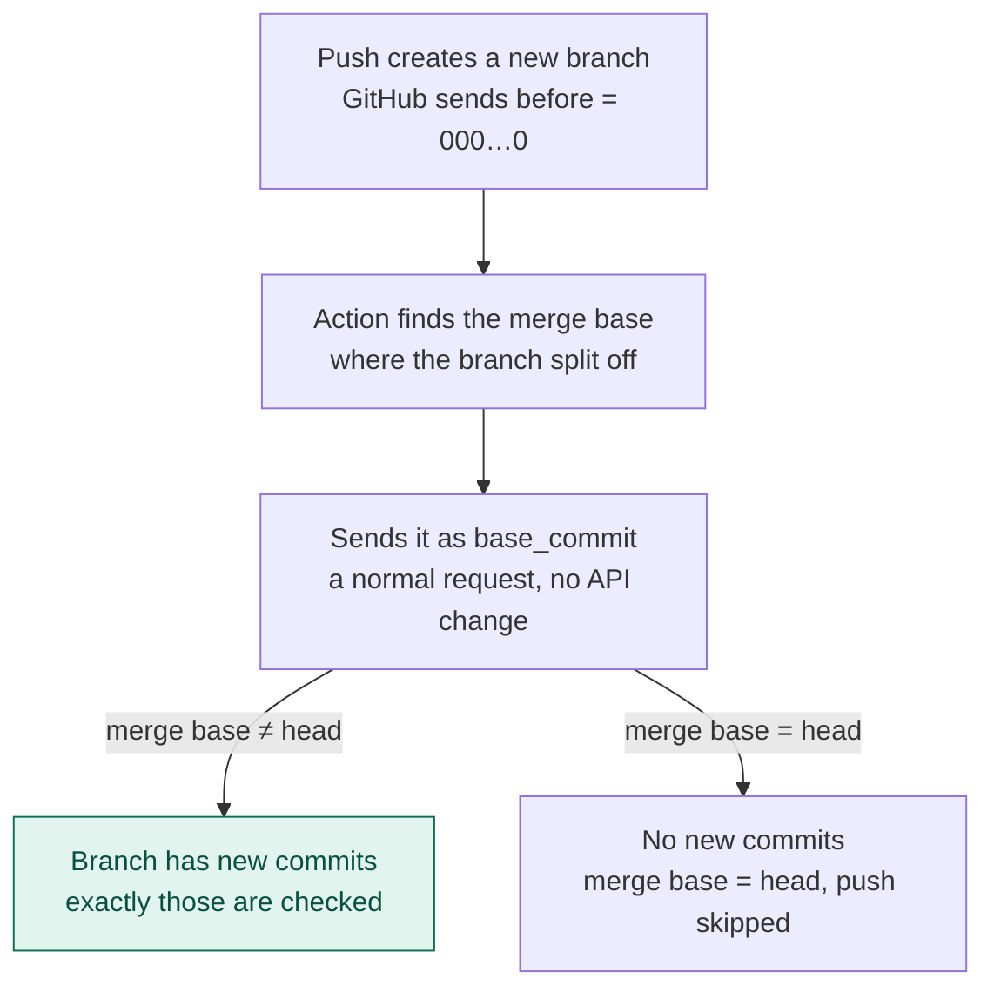

# Decision log

Every decision, with its reason, oldest first. "Still open" at the end lists what is not decided yet. A new session goes at the end as its own section, dated in its heading.

Kaan answered eighteen questions about v1 on 2026-10-17. Each entry gives the question, the answer and the reason for it. The [roadmap](roadmap.md) carries the same decisions in its v1 section and its decisions table (rows 4, 16 and 18–22).

## Scope and the LLM

**Q1 · LLM at runtime.** Should v1 keep the LLM out of the running system, as [the product vision](../vision/README.md) §7, §8.2 and §9.1 say?
**Answer:** No. An LLM is the component that decides drift.
**Why:** Kaan's direction for the project is that the LLM makes the drift call. This overrides the spec's "GenAI will not be part of the running system".

**Q9 · When the LLM comes in.** Which version brings the LLM in?
**Answer:** v1, split in two. v1.1 is git change detection only, and v1.2 adds the LLM. In v1.2 the LLM is probabilistic on purpose; the final version is deterministic.
**Why:** Getting the git half working and matching the reference service first gives a solid base. The LLM then goes on top of output that is already tested.

**Q10 · Mapping file.** Does v1.2 need an authored mapping file of which doc covers which code?
**Answer:** No. Neither v1.1 nor v1.2 has one. The LLM reads the changed files and the repo's doc files directly. The mapping comes in v1.3 if time allows, otherwise in v2.
**Why:** It keeps v1.2 small. A mapping can narrow what the LLM reads once it exists.

**Q11 · LLM provider (replaced by Q18).** Use the Claude API, with the key on Render?
**Answer:** Yes at first, then replaced by Q18.
**Why:** Render's free tier (512 MB) can't run a local model, so the LLM has to be a hosted API. Q18 then picked a free one.

**Q18 · Starting provider.** Which LLM provider does v1.2 start on?
**Answer:** Google Gemini's free tier (a Gemini Flash model, 1M-token context), behind one function, with the provider and model set in config and the key in a Render environment variable.
**Why:** It is free while v1.2 is experimental, and its context easily holds the 200 KB doc budget. Moving to Claude Haiku 5.5 (under 1¢ per analysis) or another provider later is a config change. Google can change the free tier's daily limits, and a rate-limited call fails the analysis (Q16).

**Q15 · Model choice (withdrawn).** Use Claude Sonnet 5.5?
**Answer:** Withdrawn after Q18, since v1.2 starts on Gemini.
**Why:** The question applied only to the Claude API.

**Q12 · Repeat-run matching.** Relax AC-10 and the conformance test for `issues[]` in v1.2?
**Answer:** Yes. `changes[]` must still match exactly. For `issues[]` the tests check only the shape: each finding names a real changed file and a real doc file, and has a valid issue type. The exact check returns in the final version.
**Why:** A probabilistic LLM can give different findings on the same input, so an exact check would fail at random and say nothing. `changes[]` comes from git, so it can stay strictly tested.

**Q13 · Confidence field.** Add a confidence score to `Finding`?
**Answer:** No. `Finding` keeps the reference service's shape, and the LLM's reasoning goes in `explanation`.
**Why:** Adding a field changes the contract we share with the pod and could break their tester.

**Q14 · What the LLM reads.** Send every doc file at head, up to 200 KB in total?
**Answer:** Yes. The cap is a config value. Docs past it go to `skipped[]` with an "over doc budget" reason.
**Why:** 200 KB is about 50,000 tokens. It fits in one call with room for the changed code, and most class-sized repos have less. A larger cap costs more time and money per analysis and pushes against the 120 s deadline (Q7). Whatever isn't sent is listed as skipped, never reported as checked.

**Q16 · LLM failure.** Fail the whole analysis when the LLM call fails?
**Answer:** Yes. It returns 500 `LLM_UNAVAILABLE` and saves nothing. This error code is new, beyond the pod's contract.
**Why:** Returning SUCCESS with an empty `issues[]` would look like "no drift found" when the docs were never checked (REQ-05).

## Git change detection (v1.1)

**Q2 · Hunks.** Drop line-level hunks (`git diff -U0` and `unidiff`) from v1?
**Answer:** Yes. Connector test 1 now checks only for one MODIFIED change.
**Why:** Nothing in the contract or v2 reads hunks, so they were a dependency with no user. v1.2 can still hand the plain `git diff` text to the LLM.

**Q3 · Copies.** Detect COPIED changes?
**Answer:** No. Renames only, using `-M` at git's default 50% similarity, so COPIED never appears.
**Why:** Adding `-C` could turn plain ADDED files into COPIED ones and disagree with the reference service. The conformance test shows what the pod does, and switching later is a one-flag change.

**Q4 · Renames across the hidden-path rule.** How are renames into or out of a hidden path reported?
**Answer:** Each side is filtered separately. `.github/a.md` → `docs/a.md` is ADDED, and `docs/x.md` → `.archive/x.md` is DELETED.
**Why:** The rule that hidden paths never appear stays absolute, even as `old_path`.

**Q5 · Unusual base commits.** Accept any `base_commit`?
**Answer:** Yes, and diff exactly what was given. A base equal to the head gives an empty `changes[]` and SUCCESS. A base after the head, or from unrelated history, gives whatever `git diff base head` says.
**Why:** The API stays simple and predictable. Choosing a sensible base is the caller's job, and the v3 Action does that.

**Q6 · Short SHAs.** What happens to a short SHA that can't be fetched, or that matches more than one commit?
**Answer:** 404 `COMMIT_NOT_FOUND`, with a message asking for the full 40-character SHA.
**Why:** GitHub only lets you fetch a commit that isn't on a branch or tag by its full SHA. Reusing an existing contract error code adds nothing new, and the Action always sends full SHAs anyway.
**Update (2026-10-17, after the first conformance run):** the reference service answers the same case with "commit 1234567 was not found in owner/name". Kaan kept our message; it is the one named known difference in `tests/reference.py` (`KNOWN_CASE_DIFFERENCES`). Every other message, the unknown-run body (`ANALYSIS_NOT_FOUND`) and the schema now match the reference service.

**Q7 · Time limits and concurrency.** What deadline, git timeout and number of simultaneous analyses?
**Answer:** 120 s per analysis, 60 s per git call, and two analyses at once, all in config.
**Why:** Two blobless clones fit in Render's free-tier 512 MB, and the values can change without code changes.

## Project vocabulary

**Q8 · Glossary location.** Commit CONTEXT.md to the repo, and define the pod's service?
**Answer:** Yes. CONTEXT.md sits at the repo root and defines **Reference service**: the pod's live v1 service that our output must match.
**Why:** The glossary then lives with the code it describes, and "the pod" was being used without a definition.

**Q17 · Planning files in the repo.** Commit `docs/plan/` and `docs/Models/v1/`?
**Answer:** Yes, on the `kaan_v1` branch, with no merge until Kaan says so.
**Why:** Teammates can then work from the same plan and decisions on GitHub.

## Later the same day

**Hosting (roadmap decision 8).** Render's free tier needs a card on file, and the card wouldn't verify, so Kaan moved hosting to Railway, whose Free plan needs no card. Where Q7, Q11 and Q18 above mention Render, read Railway: the Gemini key goes in a Railway environment variable, and two clones fit in its 0.5 GB.

**Probed later the same day (Kaan's Chrome, against the reference service).**

*Course routes (tickets 14 and 15).* `POST /system/test/setup` takes `TestSetupRequest` (`session_id`: 1 to 200 characters, required; `setup`: any object, optional; extra fields ignored) and answers 201 `{"session_id"}`. A repeated id is 409 "session X already exists". `GET /system/test/report?session_id=` answers 400 "session_id query parameter is required" without an id, 404 "session X is unknown" for one never set up, and otherwise 200 `{"session_id", "coverage": {"code": {"covered", "total", "basis"}}}`. Every error body is `{"message", "source": "system"}`, and setup's validation messages copy analyze's style ("session_id is required", "session_id has the wrong type", "setup has the wrong type", "body has the wrong type", and pydantic's own wording for the length limits). Inputs probed for these messages: `{}`, no body, a JSON `null` body, a non-JSON body, JSON sent as `text/plain`, `[1]`, an empty, a 201-character, a whitespace-only and a slash-containing `session_id`, `session_id` as `7` and `null`, `setup` as a string, `null` and `[1]`, and an extra field (accepted). The report counts executable lines of their package that ran while handling *any* request since the session's setup, not only requests that name the session: an analysis sent with no session id raised the count as much as one sent with it. Kaan chose to build the real report now (2026-10-17). Ours counts the v1 modules of `GitHub_Connector`, leaving out v0's webhook files (they never run in the `/system` app) and `course.py` itself, so asking for a report doesn't change it, as on theirs, where back-to-back reports gave the same count. It measures them with Python line events and coverage.py's statement lines, so `total` and `covered` differ from theirs by design. A setup with no body, or with a JSON `null` body, is the one message we didn't copy: theirs says " is required" with an empty field name, ours says "body is required". Kaan to agree before it becomes a known difference (agreed that evening: T12-Q4 below). The pod still has to confirm these semantics.

*Ticket 12 probes.* Seven public commits went to both services: `psf/requests` 0a760ff0 (Pipfile.lock), `pallets/flask` ff6fa22f (uv.lock and more), `pallets/flask` 40e0024d (a small PNG), `encode/httpx` d4961b9f (a 1.9 MB PNG), `psf/requests` 724ae127 (a 2.1 MB text .ai file), `psf/requests` 784fe8bb (a non-UTF-8 .ai file) and `pallets/flask` ac302fb6 (CHANGES.rst whose old version isn't UTF-8). Base commits matched every time. Three behaviours differ:

1. **A skipped file stays in `changes[]` on theirs**, and is listed again in `skipped[]`. Ours leaves it out of `changes[]`, as the connector guide says.
2. **They skip by file type, with a code as the reason.** Every reason seen was `UNSUPPORTED_FILE_TYPE`: `.lock` lockfiles, `.png`, `.svg`, `.ai` and `.html` were skipped, while `.py`, `.rst`, `.toml`, `.yml` and `.yaml` were not, whatever their size or encoding (the 2.1 MB `.ai` and the non-UTF-8 `.ai` got the same code, and the non-UTF-8 CHANGES.rst wasn't skipped). Ours skips by content, with the reasons "binary file", "file larger than 1 MB" and "not valid UTF-8", and lockfiles are ordinary OTHER files. This answers roadmap decision 17: on theirs a lockfile is OTHER in `changes[]` and also skipped.
3. **They list hidden paths.** `.github/workflows/*.yaml` and `.pre-commit-config.yaml` appear in their `changes[]`; our hidden-path rule (spec story 25, roadmap decisions 9 and 19) drops them.

Also seen, and already allowed: `docs/overrides/partials/nav.html` is DOCUMENTATION here and OTHER there. No public commit switching a symlink to a file was found, so that probe waits for the test repo (ticket 11).

**Route list at `/system` (Kaan, later the same day).** Plain `/system` answers with a JSON list of the routes, so a person opening the base URL sees what's there instead of 404. The reference service has no such route. It is left out of the OpenAPI document and out of the conformance set, so the schema comparison is unaffected.

**Public test repo (ticket 11, later the same day).** Published under Kaan's account as `kaan-kanadasi/DocumentationDrifter-testrepo`, since this session could create repositories only there. The online label tests use it by default. Comparing its labels with the reference service stays off (turned on with DRIFTER_LABEL_CONFORMANCE=1, which neither workflow sets) until the three ticket 12 differences are settled, so CI and the acceptance run can stay green.

## Ticket 12 grilling, the same evening

Kaan settled the three ticket 12 differences and two smaller items. Each entry gives the question, the answer and the reason for it.

**T12-Q1 · A skipped file in `changes[]`.** The reference lists a skipped file in `changes[]` as well as in `skipped[]`; ours lists it only in `skipped[]`. Match?
**Answer:** Yes. Every changed path that isn't ignored is in `changes[]`, with its change type and category, and a skipped one is also listed in `skipped[]`.
**Why:** `changes[]` says what git saw change, which is true whether or not the file could be read, and from v1.2 it must match the reference exactly. M3's "every path ends in exactly one place" was our own rule, and the course spec only asks that unchecked files appear in the skipped list.

**T12-Q2 · What is skipped, and the reason.** The reference skips by file type with the code `UNSUPPORTED_FILE_TYPE`; ours skips by content with a sentence. Copy theirs, keep ours, or combine?
**Answer:** Combine. A denylist of extensions in the rules file (`.lock`, `.png`, `.svg`, `.ai`, `.html`, the five seen skipped) is checked first and gives `UNSUPPORTED_FILE_TYPE`. Our content checks stay after it as a safety net, with codes in the same style instead of sentences: `BINARY_FILE`, `FILE_TOO_LARGE` and `NOT_UTF8`. A file of a type the reference accepts that fails a content check (the test repo's `oversize` and `non-utf8` labels) is a known difference resting on REQ-05: nothing unread is reported as checked, which matters once v1.2 sends files to the LLM. The pod is asked for their full list; until then it's a denylist, not an allowlist.
**Why:** It matches the reference on every case probed, keeps unreadable files away from the v1.2 LLM, and a denylist that misses one of their types costs only a missing `skipped[]` entry, while an allowlist could wrongly skip common text files such as `.js` or `.json`. The list lives in the rules file, so a change to it shows in `config_version`.
**Also closes:** roadmap decision 17 (a lockfile is OTHER in `changes[]` and skipped as `UNSUPPORTED_FILE_TYPE`), and the to_do item "the skip reason follows the size setting", since the code no longer names 1 MB.

**T12-Q3 · Hidden paths (reversed by T12-Q8 below).** The reference lists `.github/workflows/*.yaml` and `.pre-commit-config.yaml` in `changes[]`; ours drops every path with a segment starting with `.`. Match?
**Answer:** Yes. Hidden paths are reported in `changes[]` and categorised by the path rules like any other path, and a rename across a hidden path is one RENAMED change, as git reports it. Symlinks and submodules stay ignored until the test repo's `symlink-to-file` label is compared with the reference.
**Why:** The hidden-path rule was ours (the connector guide's "your hidden-file rule"), nothing in the course spec asks for it, and it isn't a fault in the reference, so it can't be a known difference. This supersedes roadmap decisions 9 and 19, Q4 above, and spec user stories 25 (its hidden-path part) and 26.

**T12-Q4 · The no-body setup message.** A setup with no body, or a JSON `null` body: copy the reference's " is required" (empty field name), or keep ours?
**Answer:** Keep "body is required". It is a known difference resting on a fault in the reference service, and it goes in the fault report to the pod alongside T-04.
**Why:** Their message names no field, so it doesn't tell the caller what is missing, which is what an error must do (AC-07). Copying it would copy a bug.

**T12-Q5 · `tool_version` names the build** (review finding b). Report `1.1.0+<first 7 characters of RAILWAY_GIT_COMMIT_SHA>` when that variable is set, and `1.1.0` otherwise?
**Answer:** Yes. `tool_version` joins `config_version` in the fields the conformance test allows to differ (`KNOWN_DIFFERENT_FIELDS` in `tests/reference.py`). A test sets the variable and checks the result. *Correction found while building ticket 16:* `tool_version` is already in `VOLATILE_FIELDS` in `tests/reference.py`, so the conformance test ignores it today and needs no change.
**Why:** Spec user story 6 needs the result itself to say which build produced a run, and today every deploy reports `1.1.0`. The reference service reports the same string as ours now, so the suffix makes the field differ by design, the same way `config_version` does. This is the one known difference that rests on neither a fault nor an open question; Kaan accepted it for traceability.

**T12-Q8 · Hidden paths, reversed.** Minutes after T12-Q3, Kaan reversed it: a hidden path such as `.gitignore` is out of scope. Is it ignored (in neither list) or skipped (in `changes[]` and `skipped[]` with a reason)?
**Answer:** Ignored, as before.
**Why:** A skipped file is one we meant to check but couldn't; `.gitignore` is out of scope, not unreadable. Listing it as skipped would also differ from the reference in two places instead of one.

**T12-Q9 · Which hidden paths?** Only `.gitignore`, only top-level dot-files, a named list, or every path with a segment starting with `.`?
**Answer:** Every dot-path, as before. Roadmap decisions 9 and 19, Q4 above and spec user stories 25 and 26 stand again: `.github/` is dropped, and a rename across a hidden path is ADDED or DELETED.
**Why:** It's the rule the code, tests and test repo already implement, and a simpler rule to explain than a partial one. Since the reference lists hidden paths in `changes[]`, this is a known difference by Kaan's choice, like `tool_version` (T12-Q5), not one resting on a fault: the test repo's `hidden-paths` and `renames-across-hidden` labels, and any real commit touching a dot-path, will differ.

**T12-Q6 · One ticket or two?** Ticket 12's own rule says a difference that needs more than a small fix becomes its own ticket.
**Answer:** Split. Ticket 16, "Match the reference on skipped files", holds T12-Q1 and T12-Q2 and the test-repo republish, and blocks the rest of ticket 12. Ticket 12 keeps the `tool_version` change, the known differences, the pod report and the final run.
**Why:** The denylist, the reason codes and keeping skipped files in `changes[]` touch the connector, the rules file, two test files and three test-repo labels, and mean republishing the public test repo. (Before T12-Q8 the hidden-path change made it larger still.) Smaller tickets keep each `/implement` run short.

**T12-Q7 · Loose ends for v1.2.** Should the doc-budget reason become a code (`OVER_DOC_BUDGET`)? (A second point, whether hidden docs go to the LLM, fell away with T12-Q8: hidden paths never reach it.)
**Answer:** Parked for the v1.2 grilling, and listed as an open point in the roadmap's v1.2 section.
**Why:** Neither changes v1.1.

## Ticket 12 live run, the same night

The whole conformance set, with the 23 test-repo labels (DRIFTER_LABEL_CONFORMANCE=1), ran from Kaan's machine against the reference service. psf/requests d568f47 and every other real-repo and error case matched; four labels didn't, for the two reasons below. A setup with no body joined the set as the `course-setup-no-body` case, with its message as a known difference (T12-Q4); the reference answers `{"message": " is required", "source": "system"}`.

**T12-Q10 · Symlinks and submodules.** The reference lists a new symlink (`link-to-readme`, `mixlink`) or submodule (`vendor/lib`, `vendor/other`) in `changes[]` as ADDED and OTHER, and skips it as `UNSUPPORTED_FILE_TYPE`. A file-to-symlink switch is one TYPE_CHANGED change and is not skipped. Ours ignores all of these. Match?
**Answer:** Yes, in ticket 17, since it needs more than a small fix (the connector, the test repo's labels, M3 and a republish). Until then the paths are listed per label in `LINK_PATHS` in `tests/reference.py` and removed from the reference's answer before comparing.
**Why:** Like a skipped file (T12-Q1), a symlink or submodule is a path git saw change, and the course spec doesn't ask us to hide it.

**T12-Q11 · Shell scripts.** The reference classifies the executable `run.sh` (label `mixed`) as IMPLEMENTATION; ours said OTHER, because no rule matched. Match?
**Answer:** Yes. `*.sh` → IMPLEMENTATION joins the rules file after `*.py`, so `config_version` changes. Whether they decide by the extension or the executable bit wasn't probed; the rule follows the extension, like every other rule.
**Why:** A small fix inside the contract, and a shell script is code.

**Defaults from other tickets, confirmed against the reference that night:**

- A skipped file stays in `changes[]` (T12-Q1, built in ticket 16): confirmed by every label that skips one.
- Lockfiles (roadmap decision 17): OTHER in `changes[]` and skipped as `UNSUPPORTED_FILE_TYPE` (T12-Q2): confirmed.
- A symlink-to-file switch: TYPE_CHANGED on both services (label `symlink-to-file`), so ticket 05's default stands. The reverse switch differs until ticket 17 (T12-Q10).
- Skip reasons: codes, not sentences (T12-Q2). `UNSUPPORTED_FILE_TYPE` matches; our extra `BINARY_FILE`, `FILE_TOO_LARGE` and `NOT_UTF8` stay a known difference resting on REQ-05.
- The unknown-run 404: `{"code": "ANALYSIS_NOT_FOUND", "message": "analysis <id> does not exist"}` on both (ticket 03), for an unknown and a malformed id.

## Decision 15: the base for a push that creates a branch, 2026-10-17

**Question:** when a push creates a new branch, GitHub sends 40 zeros as `before`. What base commit should the analysis compare against?

**Decision (Kaan, 2026-10-17, roadmap decision 15):** the merge base with the default branch, which is where the branch split off. A first audit (no base, every file ADDED) happens only when the head is a root commit, the first commit of a repo.

This affects the v3 GitHub Action and the v4 webhook, which decide what base to send. The v1.1 service doesn't change either way. It already compares against the parent when `base_commit` is left out, does a first audit for a root commit, and answers a base of 40 zeros with 404 `COMMIT_NOT_FOUND`.

### Before: the schema's literal reading

[Schema v14](../vision/documentation-tracker-schema-v14.pdf) defines a first audit as an analysis with no base snapshot, and the product vision's M4 ([diagram](../vision/05-M4-run-file-schema.png)) has the Action send "push before". Read together, a push that creates a branch would be a first audit. The v0 receiver (`Source/GitHub_Connector/parse.py`) was written that way.

Why it doesn't work:
1. **The shared API can't ask for "no base" when the head has a parent.** Leaving `base_commit` out means "compare with the parent", and 40 zeros isn't a commit. Only a root commit can be a first audit.
2. **Even if it could, it would check nothing useful.** A first audit lists the whole repo as ADDED, and schema v14 gives it "resolution checks only", meaning no findings. The branch's real changes would never be checked for drift.

### After: decision 15

- The merge base comes from `merge_base_commit` in GitHub's compare endpoint, `GET /repos/{owner}/{repo}/compare/{default}...{head}`. The Action makes the same call for pull requests (decision 10) and force pushes, so this adds no new machinery. A sketch of the workflow is in [actions readiness](reports/actions-readiness.md).
- The v3 Action runs on pushes to the default branch and on pull requests. A push that creates a branch therefore reaches it only once: the push that creates the default branch in a new repo. There the merge base equals the head, so it is skipped. Feature branches are checked through their pull requests.
- In v4, the webhook receives every push. This rule is what lets it check a new feature branch's own commits.

### Proposed, not decided: a first audit instead of a skip

When the default branch is first created and its head is a root commit, the Action could leave `base_commit` out instead of skipping. The service would then do a first audit, which is exactly the schema's behaviour, and the only case the shared API can express. If several commits were pushed at once, the service would compare the last one with its parent. Kaan to decide.

### What it changes from the schema

- **Unchanged:** a first audit still means an analysis with no base.
- **Clarified:** when one happens. A first audit happens only when the head is a root commit. A push that creates a branch compares against the merge base with the default branch.
- **Refined in the product vision's M4:** "Action: PR base or push before" becomes the merge base for pull requests (decision 10), for force pushes, and for new branches (this decision). For a normal push, it stays the push's `before`.

### Where it is recorded

- [Roadmap](roadmap.md), decision 15 and v3 item 2
- [Connector guide](history/github-connector-steps.md), step 3's base table
- [CONTEXT.md](../../CONTEXT.md), "First audit"
- [docs/Models/v1](../Models/v1/README.md): M3 (a first audit is a root commit) and M4 (`base_commit` is null only for a root commit)
- v0's `parse.py`: the property is now `has_before`, renamed from `needs_base_snapshot`, and its comment and test follow this decision (2026-10-17)

## A basic UI in v1, served at `/`, 2026-10-18

Grilled with Kaan before v1.2, so the backend can be used by hand first (ticket 18).

- **In v1, not v2 (Kaan).** The roadmap left a UI out of v1, and v2 item 5 offered a viewer only if the course required one. The console in `Source/Frontend/` already calls only `POST /system/analyze` and `GET /system/analysis/{id}`, so it works against v1.1 unchanged and shows v1.2's `issues[]` without more work.
- **Served by the v1 app at `/` (Q1, Q5).** One URL for the team and nothing else to host. The route sits outside `/system` and is left out of the OpenAPI document, so the contract and conformance don't change. A separate host would need CORS; local-only would help no one else.
- **The page is unchanged (Q2, Q6, Q8).** It analyses and looks up runs, and keeps its repo watching, its API address field and `?demo`. It doesn't call the course routes.
- **`ui.py` stays (Q7)** as the way to run the console against an API elsewhere.
- **Done means (Q4, Q10, Q11):** pytest tests at the HTTP app, a local run against the ticket 11 test repo, and the same run on Railway after Kaan says push.
- **Left for a complete solution (Q12):** each viewer's browser polls GitHub on its own unauthenticated budget of 60 calls an hour. At the default 300 s that is about 5 watched repos; past it the page pauses until the reset. Noted in `.scratch/v1-1-change-detection/to_do.md`.

## The cross-team tester, 2026-10-18

Grilled with Kaan after reading the course's cross-team testing interface (student-facing spec) and running the reference team's tester (`https://doc-tracker-5t4s.onrender.com/tester`) against their own system: 17 pass, 6 skip, 23 tests T-01 to T-23, coverage reported as code, component (C1 to C7) and system (AC-01 to AC-10).

**TT-Q1 · Which category table is the pod's single source of truth? (superseded by TT-Q7 the same hour)** Ours adds DOCUMENTATION; the reference's contract (system OpenAPI v0.3.0) has IMPLEMENTATION, DESIGN, ARCHITECTURE, SPECIFICATION, REQUIREMENT and OTHER, and their T-04 checks the four design-side categories.
**Answer:** The reference team's model. Their OpenAPI enum is the contract, and their tester's T-01 to T-23 are the model for our tester. DOCUMENTATION leaves `Change.category` and `Finding.change_category`; doc files take whatever category the reference gives them (OTHER for `docs/**`, `*.md`, `*.rst` as probed on 2026-10-17).
**Why:** A value outside the shared enum fails schema validation, so one shared tester can't grade both systems while it stays. This reverses roadmap decision 2 and removes the "doc files are DOCUMENTATION here" known difference. The path rules that give DESIGN, ARCHITECTURE, SPECIFICATION and REQUIREMENT are still to be read off the reference (their T-04).

Kaan agreed to the next five the same afternoon, each as recommended:

**TT-Q2 · The shared test list.** Our tester runs the reference tester's T-01 to T-23 with the same meanings and the same skips (T-18 to T-23 wait for Phases 4 and 5). The other team is asked for their cases (test repo, commits, expected changes) as one file that both testers load.
**Why:** The two suite reports then line up test by test, and handing our tests to the other team is handing over one file.

**TT-Q3 · Coverage.** Copied exactly: component coverage counts the pod's components C1 to C7 and system coverage counts AC-01 to AC-10, each covered when at least one executed test exercises it, with the covered IDs listed in `basis`. Code coverage comes from the target's `/test/report`. C1 to C7 are not in our repo; the other team is asked for the list, which goes into `docs/spec.md`.
**Why:** Both testers must count from one list, or the same suite gives two different coverage numbers.

**TT-Q4 · Where the tester lives.** In the same Railway app at `https://documentationdrifter-production.up.railway.app/tester`, beside `/system`, as the reference does. The registry's tester URL changes from `/system/test` (the system's own test routes) to `/tester`.
**Why:** The course spec allows different paths on one host; it is one deploy, and our tester tests our own `/system` over HTTP like any other target.

**TT-Q5 · Time limits.** 90 s per project call and 600 s per suite, with each result saved as it arrives so `GET /test/report` keeps partial results after an abort or a lost response. Both numbers go in the registry's run notes. To be checked against how long the reference tester took on our system (its first run, 2026-10-18 16:50, hadn't ended after 15 minutes).
**Why:** A cold Render start alone can exceed 50 s, and T-17 makes five analyses in a row.

**TT-Q6 · Sessions.** System setup takes `setup: {}`; nothing is prepared or reset, and sessions may run at the same time. The shared spec says that on both services the code-coverage count includes requests from any session since setup.
**Why:** Every case uses fixed public commits, so there is no state to prepare, and both services already count this way.

**TT-Q7 · Team 16's contract v1.1 proposal (Parth Gupta, 2026-10-18).** Their eight rows, answered by Kaan as recommended, plus a ninth of ours. Each needs Team 16's agreement before it counts, and the date and channel go in Phase 3, Q3.2 and Q6.2.

1. **`repository` is owner/name.** Agree; we already require it.
2. **The findings list is `issues`.** Agree; we already use it.
3. **Always return `config_version` and `created_at`.** Agree, with a counter: `config_version` is the version string declared inside the shared mapping file, so both systems report the same value and the `config_version` known difference goes.
4. **Full 40-character SHAs, `base_commit: null` for a root commit.** Agree; we already do.
5. **Missing repo or commit is 404; a mapping problem inside a valid commit is a saved 200 result with `status: ERROR`.** Agree. Nothing changes in Phase 3; our spec's "every saved run is SUCCESS" changes with v1.2, as the product vision's M2 had it.
6. **One shared `mapping-v1.1.yaml`, DOCUMENTATION at lowest precedence** (REQUIREMENT, SPECIFICATION, ARCHITECTURE, DESIGN, IMPLEMENTATION, DOCUMENTATION, OTHER, first match wins). Agree. This supersedes TT-Q1: DOCUMENTATION stays (roadmap decision 2 stands), and the removal made earlier that hour was reverted before it was committed. Our `path_rules.json` is replaced by their file, loaded verbatim, once they publish it; the table's "and other code" is not precise enough to build from. Under their order `docs/conf.py` is IMPLEMENTATION, and a `*.rst` or `*.txt` outside `docs/` is OTHER.
7. **One skip reason, `UNSUPPORTED_FILE_TYPE`.** Agree. Our content checks stay as the safety net (REQ-05), but every skip they cause is reported as `UNSUPPORTED_FILE_TYPE`. This retires `BINARY_FILE`, `FILE_TOO_LARGE` and `NOT_UTF8` (T12-Q2) and fixes their T-05 on our system.
8. **Components C1 to C7 as the shared coverage list.** Agree; it settles TT-Q3. C1 interface, C2 repository fetch, C3 change detection and classification, C4 mapping detector (Phase 4), C5 result building and persistence, C6 saved-result retrieval, C7 review workflow (Phase 5).
9. **Ours: hidden paths.** We propose switching to their behaviour, listing dot-paths such as `.github/` in `changes[]`. T12-Q9's rule was ours, not the contract's, so it isn't a defensible difference once a fixture touches a dot-path.

**Why:** Each row closes a gap that made one team's tester fail the other team's correct system; the shared mapping file also gives the DESIGN, ARCHITECTURE, SPECIFICATION and REQUIREMENT rules we lacked for T-04.

**TT-Q8 · The fixture repo.** The shared test list runs against Team 16's public `ParthGupta06/doc-tracker-fixtures`, which is the jointly owned test repository Phase 2 §4.2, §5.3 and §9.1 call for. Our `DocumentationDrifter-testrepo` stays as an internal regression set.

Kaan left the last three to the recommendation:

**TT-Q9 · Pass or fail.** Copied from the reference tester, plus one check from Phase 2. Change tests (T-01 to T-07) compare `changes[]` as an unordered set of (path, old_path, change_type, category); T-05 also checks the skipped paths, T-07 also `base_commit: null` and all ADDED. Error tests (T-08 to T-13) match HTTP status and error `code`, and need a non-empty `message` (AC-07, AC-08), never exact wording. T-14: the GET body equals the POST body. T-15: an unknown id is 404 `ANALYSIS_NOT_FOUND`. T-16: two runs, two ids, both retrievable unchanged. T-17: five runs agree on every field but `analysis_id` and `created_at` (`tool_version` counts, Phase 2 §5.1). An unlisted 5xx is `error` with source `system`; no response is `error` with source `communication`.

**TT-Q10 · A hung run.** A watchdog stops the suite at 600 s: the test in flight becomes `error`/`communication`, untried tests `skip`, and the report is stored, so `GET /test/report` never answers 409 forever. A second `/test/run` on the same session is 409. The reference tester's session `7db7828e-a65c-4b03-87b7-2e05d780eafe` against our system shows the fault this prevents (still 409 after 20 minutes).

**TT-Q11 · What to build first.** The whole tester now: the three `/tester/test` routes, the outcome and coverage rules, and T-01 to T-23 against the fixture repo, with T-18 to T-23 skipped for the reference tester's reasons (Phase 3 covers AC-01, AC-07, AC-08 and AC-10, Phase 2 §6.1). T-01 to T-07 take today's expected changes and are rechecked when `mapping-v1.1.yaml` is published.

**TT-Q12 · Whose rules does our tester follow? (Kaan, the evening of 2026-10-18)** Team 16 agrees to nothing their own test suite doesn't check.
**Answer:** Team 16's tester, line for line. Its source is public (`ParthGupta06/doc-tracker`, `doctracker/tester/suite.py` and `commits.json` at `0db21ca`), and our tester copies its requests, expected answers, pass rules and tags. This reverses, for the tester only: TT-Q7 row 6's DOCUMENTATION in the expected answers (doc files are OTHER, as their contract has no DOCUMENTATION); our own T-06 pair (theirs is `c3-rename` with base `c0-initial`); TT-Q9's "`tool_version` counts" (their T-17 compares only repository, head and base commits, status, changes, skipped and the findings without `finding_id`, on `c4-categories`); the listed-500 rule (any 5xx is the system's error); and our stricter schema check (theirs checks field types, status, change strings and `PENDING_REVIEW`). It adds their checks we lacked: T-01's default base, `status: SUCCESS` on every analysis, and their exact error requests. Their live tester against their own system, the same evening, passed T-01 to T-17 with component 5/7 and system 5/10.
**Why:** The two testers must give the same verdict on the same system, and Team 16 has agreed to nothing else. Our own system now fails T-02 and T-06 on DOCUMENTATION for `docs/model.md`, which TT-Q7 row 6 would have kept; whether our system drops DOCUMENTATION is a separate decision.

**TT-Q13 · How far does our system match Team 16's behaviour? (Kaan, the evening of 2026-10-18)** The endpoints, fields and answers must match, the implementation must be our own.
**Answer:** The same answers for any file, not only the fixture repo. Read off their public system code (`doctracker/system/classify.py`, `analysis.py`, `mapping-v1.yaml` at `0db21ca`), as behaviour to match, never code to copy: categories by their ordered path patterns with no DOCUMENTATION (ticket 07); `skipped[]` by their supported extensions and file names alone, with no content checks and no symlink rule (ticket 06, replacing TT-Q7 row 7's safety net); hidden paths listed (ticket 08, not waiting on row 9); a saved 200 `status: ERROR` result with `CHANGE_LIMIT_EXCEEDED` above 2000 changed files (ticket 12). `config_version` stays our own, because no shared test checks it.
**Why:** A grader may analyse any repository, not just the fixture, and the student-facing spec says behaviour must match the shared specification while teams choose their internal implementations.

## `kaan_test` port and deployment (2026-10-18)

Kaan requested the useful v1.2 changes from `main` be copied into `kaan_test`, retaining TT-Q13's contract, and authorized committing and pushing that branch. No merge into `main` is required. Railway must use `kaan_test` as its source branch before this version is deployed; a push is not proof of a successful deployment.

Documentation selection is independent of the six reported categories. Docs past the 200 KB input budget are counted only in the prompt, without new public skip reasons. This supersedes the earlier v1.2 ticket's DOCUMENTATION and OVER_DOC_BUDGET wording. Missing-documentation detection and the public fixture AC-02/AC-03 run remain deferred.

## Still open

- ~~**Skipped files, skip reasons and hidden paths**~~: decided that evening (T12-Q1, T12-Q2, T12-Q8 and T12-Q9). Still to ask the pod: their full list of unsupported file types, and whether they ever skip by content.
- **`/test` endpoints:** built from what the reference service was seen to do (above); the pod still has to confirm the semantics.
- **Unexpected git failures:** a git call that fails in a way the connector doesn't foresee (not a timeout, a missing repository or an unknown commit) returns FastAPI's plain-text 500 instead of an `ErrorBody`, and none of the five contract codes fits. Ask the pod what code their service uses (Kaan, 2026-10-17); asked in [pod-report-2026-10-17.md](reports/pod-report-2026-10-17.md), still to settle once they answer.
- **Repository pattern:** [M0](history/M0-build-order.pdf) uses `^[A-Za-z0-9][A-Za-z0-9-]{0,38}/[\w.-]{1,100}$`, stricter than the spec's `^[A-Za-z0-9-]+/[A-Za-z0-9._-]+$`. The spec's pattern stays until the conformance run shows what the reference service accepts (Kaan, 2026-10-17). Update, later that day: the reference's captured OpenAPI document declares M0's pattern, `^[A-Za-z0-9](?:[A-Za-z0-9-]{0,38})/[A-Za-z0-9._-]{1,100}$`. The conformance case `not-a-repo` gives the same 400 under both patterns; names the two patterns disagree on (a leading hyphen, an owner over 39 characters, a name over 100) haven't been compared yet.
- **First audit for a new repo (decision 15):** when the default branch is first created at a root commit, should the Action ask for a first audit instead of skipping? Proposed in the decision 15 section above, not decided.
